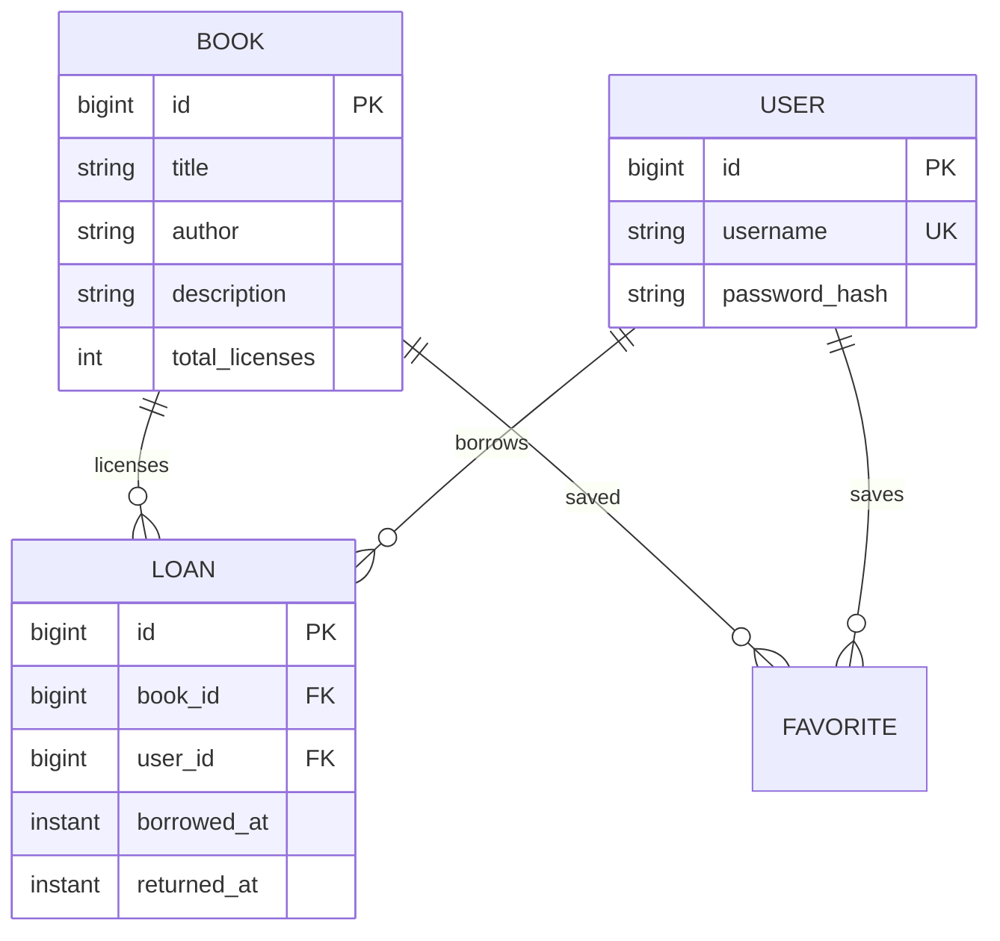
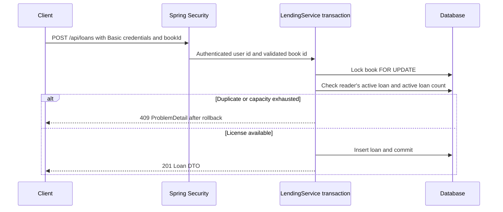

# Design decisions

The aggregate being protected is a book's allocation of concurrent reading licenses. A loan is a durable historical record, not an entry to remove when a book is returned.

## Data model

An active loan has `returned_at IS NULL`. The schema enforces referential integrity and valid timestamps. Vendor-specific migrations enforce the uniqueness of an active reader/book pair while permitting multiple returned historical loans. The total allocation limit is enforced by the transactional service protocol.

Catalog metadata includes a category, original editorial guidance, reading highlights and source references. `Favorite` stores a unique user/book relation independently of loans; removing a bookmark leaves every loan intact. Returned-loan queries retain the same loan identities and timestamps and are always scoped to the authenticated reader. The browser implements the required five tasks plus these bounded discovery and shelf additions inside the same JAR.

## Borrowing sequence

The transaction interceptor commits before the service proxy returns control to the controller. The DTO is created while the transaction is active, so its book reference does not depend on Open Session in View.

Returns obtain only a scalar book id before locking. The actual Loan is loaded after the book lock is held. This prevents a persistence-context snapshot loaded before a lock wait from overwriting the first successful return time.

## Choices and alternatives

| Decision | Why it fits | Cost or boundary |
| --- | --- | --- |
| One application, feature packages | Clear ownership and one transaction boundary for a small domain | Modules are not independent deployments |
| Relational persistence and Flyway | Durable history, constraints, repeatable schema creation | Database schema changes require migrations |
| H2 quick start plus PostgreSQL profile | Low setup cost without assuming identical engine behavior | Both engines need their own constraint migration and tests |
| Per-book pessimistic lock | Protects check-and-insert and return under a shared protocol | A hot title serializes writers; measure lock contention before scaling |
| Derived availability | One source of truth; no stock counter to double-increment on retries | Counting active loans has a query cost; indexes and paging bound the current access pattern |
| Idempotent return, conflict on duplicate borrow | Return retries are safe without an extra idempotency-key store | A lost successful borrow response is reconciled through current loans; retrying may return ALREADY_BORROWED |
| Basic authentication for review | Standard framework authentication with little integration setup | External deployment needs TLS and an appropriate identity lifecycle |
| Explicit DTOs and ProblemDetail | Stable API shape and controlled data exposure | Mapping code is written explicitly |

An optimistic alternative would update a versioned book allocation state and retry on conflicts. Adding a `@Version` field without updating that row would not protect a count followed by a loan insert. A license-per-row model could reduce contention for large capacities but adds allocation state and uniqueness rules. Neither is needed without evidence that the current lock is a bottleneck.

## Failure handling

- Business conflicts roll back and return a stable `409` code. They are not automatic-retry loops.
- Lock waits are bounded to three seconds; the API returns `503 BOOK_BUSY` and a short Retry-After value.
- A returned loan retains its timestamp, including after a new loan for the same book has been created.
- Authentication failures and controller errors use compatible problem responses. Unexpected messages and stack traces stay server-side.
- Default demo data is separate from the deployment profile. Disabling a seed profile does not undo already committed seed data.

## Verification boundaries

The same integration tests run on H2 and native PostgreSQL 16. The concurrent tests use separate threads and transactions, then inspect committed database state. Direct SQL tests confirm the uniqueness and foreign-key constraints rather than only the application checks. JAR-level delivery checks cover HTTP and restart persistence independently of MockMvc.

These are correctness checks for the implemented workflow. They do not establish production throughput, failover, multi-instance operational reliability, or backup/restore capability. Hosted CI and container execution require their own run results. No production performance figures are claimed.
